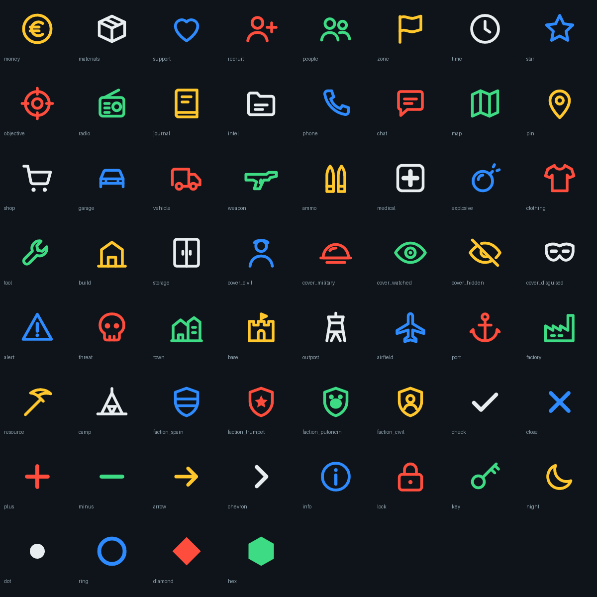

# Iconos y tema

## Iconos

Son **60 iconos** propios, dibujados en vector y metidos en un atlas de 1024×1024 (celdas de 128 px). Están en blanco para teñirlos con el color que quieras.



Cómo se usan:

```c
MCUIK.SetIcon(widget, "Icon", "money", MCUIK_Theme.Accent());   // por nombre
MCUIK.SetIcon(widget, "Icon", MCUIK_Icon.MONEY);                // con la constante
img.LoadImageFromSet(0, MCUIK_Res.ICONS, "money");              // a mano, en cualquier ImageWidget
```

En un `.layout`: `Texture "{3BA4B2A75ED412DC}UI/Textures/MCUIK/MCUIK_Icons.imageset"` e `Image "money"`.

| Grupo | Nombres |
|---|---|
| Recursos | `money` `materials` `support` `recruit` `people` `zone` `time` `star` |
| Misiones e historia | `objective` `radio` `journal` `intel` `phone` `chat` `map` `pin` |
| Servicios y objetos | `shop` `garage` `vehicle` `weapon` `ammo` `medical` `explosive` `clothing` `tool` `build` `storage` |
| Incógnito y peligro | `cover_civil` `cover_military` `cover_watched` `cover_hidden` `cover_disguised` `alert` `threat` |
| Tipos de sitio | `town` `base` `outpost` `airfield` `port` `factory` `resource` `camp` |
| Facciones (escudos) | `faction_spain` `faction_trumpet` `faction_putoncin` `faction_civil` |
| Controles | `check` `close` `plus` `minus` `arrow` `chevron` `info` `lock` `key` `night` |
| Formas | `dot` `ring` `diamond` `hex` |

Para **añadir iconos**, edita el diccionario `ICONS` de `tools/gen_icons.py` (SVG con `viewBox 0 0 24 24`, trazo blanco de 1,9) y ejecuta `python tools/build.py`. Caben 64 sin agrandar el atlas.

## Tema

| Función | Color | Uso |
|---|---|---|
| `MCUIK_Theme.Accent()` | amarillo `#FFC72C` | Acento, títulos, dinero |
| `MCUIK_Theme.Info()` | azul `#2E8BFF` | Información, secundarias |
| `MCUIK_Theme.Success()` | verde `#3DDC84` | Bien, propio, legal |
| `MCUIK_Theme.Warning()` | naranja `#FF9628` | Cuidado |
| `MCUIK_Theme.Danger()` | rojo `#FF4D3D` | Peligro, enemigo, ilegal |
| `MCUIK_Theme.Text()` | `#E8EDF0` | Texto |
| `MCUIK_Theme.Muted()` | `#8FA1AD` | Texto secundario, desactivado |
| `MCUIK_Theme.Panel(a)` | `#0E1419` | Fondo de paneles |
| `MCUIK_Theme.Rgb(r, g, b, a)` | — | Cualquier otro |

Todas aceptan transparencia: `Accent(0.2)`.

Para texto enriquecido: `MCUIK_Theme.Paint("ILEGAL", MCUIK_Theme.Danger())` devuelve `<color rgba="255,77,61,255">ILEGAL</color>`.
