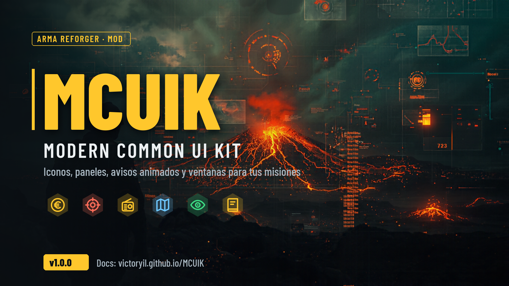
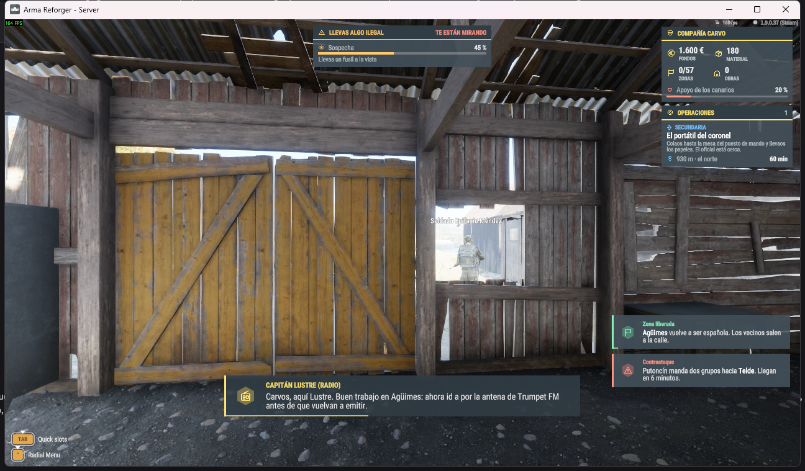
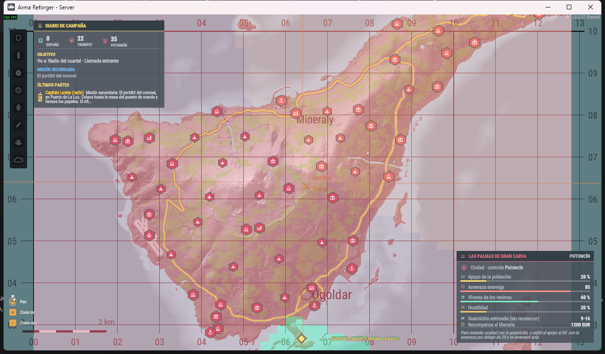

# MCUIK · Modern Common UI Kit

Kit de interfaz para **Arma Reforger** (motor Enfusion, Enforce Script). Sirve para que una misión o un mod tenga un HUD y unas ventanas modernas sin pelearse con los layouts:
- iconos propios;
- tema de colores;
- piezas para componer (panel, chip, fila, barra…);
- avisos animados;
- diálogos con quién habla;
- ventanas de lista y de evento.

No depende de ninguna misión. Se añade como **dependencia** y se usa desde script.

| | |
|---|---|
| GUID del mod | `B8DFCB8639E9DA37` |
| Prefijo de clases | `MCUIK_` (y la clase de utilidades `MCUIK`) |
| Depende de | Arma Reforger (`58D0FB3206B6F859`) |
| Lo usa | [MCES · tienda y economía](https://github.com/victoryil/MCES), Reconquista Canaria |



*Ejemplo del HUD de Reconquista Canaria:*
- **Arriba a la derecha:** panel con chips y operaciones en curso.
- **Arriba en el centro:** insignia de incógnito con barra de sospecha.
- **A la derecha:** avisos tipo tarjeta.
- **Abajo:** diálogo de quién habla.



## Qué hay en esta documentación

| Página | Para qué |
|---|---|
| [Empezar](empezar.md) | Añadir la dependencia y pintar el primer panel en 5 minutos. |
| [Piezas](piezas.md) | Panel, chip, fila, barra, texto, cajas: cómo se crean, se actualizan y se colocan. |
| [Avisos y diálogos](avisos.md) | `MCUIK_Notify`: tarjetas laterales y líneas de diálogo con voz. |
| [Ventanas](ventanas.md) | Ventanas de lista y de evento sobre el diálogo del juego. |
| [Iconos y tema](iconos.md) | Los 60 iconos, sus nombres y los colores del tema. |
| [Herramientas](herramientas.md) | Cómo se generan iconos, texturas, layouts y metas (y cómo añadir los tuyos). |
| [Guía para IA](guia-ia.md) | Reglas, pasos y errores típicos para un asistente de IA que configure el kit. |
| [Referencia de la API](api.md) | Todas las clases y métodos públicos (generado del código). |

## La idea en una línea

```c
Widget panel = MCUIK.Panel(MCUIK.CreateLayer(), "money", "TESORERÍA", 300);
MCUIK.Chip(MCUIK.Content(panel), "money", "12.500 €", "FONDOS");
MCUIK_Notify.Toast("zone", "Zona liberada", "Agüimes vuelve a ser vuestra.", MCUIK_Theme.Success());
```
