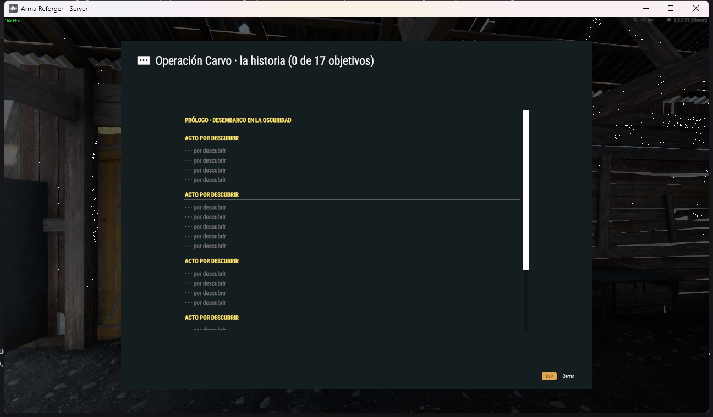
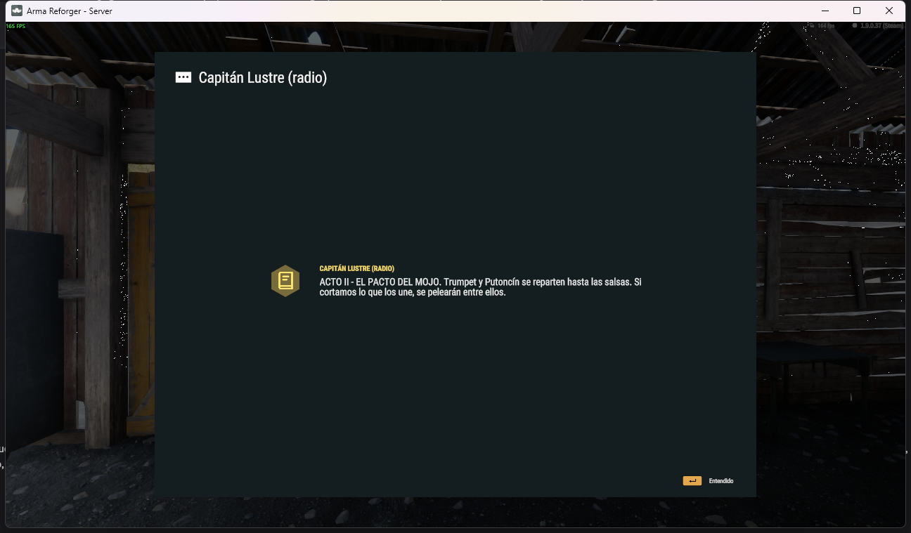

# Ventanas

MCUIK trae dos *presets* para `SCR_ConfigurableDialogUi`, el sistema de diálogos del juego. Se abren con ratón y teclado, y se cierran con Esc. Están en `MCUIK_Res.C_DIALOGS`:

| Tag | Contenido | Botones |
|---|---|---|
| `mcuik_list` | Lista con desplazamiento (`List`) de 940×600 | Cerrar |
| `mcuik_event` | Insignia grande (`BadgeIcon`, `BadgeBg`), titular (`Kicker`) y texto (`Message`) | Entendido (confirmar) |

## Ventana de lista

Hereda de `SCR_ConfigurableDialogUi` para recibir los clics:

```c
class MiLista : SCR_ConfigurableDialogUi
{
    protected ref map<SCR_ModularButtonComponent, string> m_mIds = new map<SCR_ModularButtonComponent, string>();

    static MiLista Abrir()
    {
        MiLista dlg = new MiLista();
        SCR_ConfigurableDialogUi.CreateFromPreset(MCUIK_Res.C_DIALOGS, "mcuik_list", dlg);
        dlg.SetTitle("Garaje de la compañía");
        dlg.Seccion("GUARDADOS");
        dlg.Fila("coche1", "garage", "<b>Pick-up</b> · con 3 cajas", "");
        return dlg;
    }

    Widget Lista() { return GetContentLayoutRoot().FindAnyWidget("List"); }

    void Seccion(string titulo)
    {
        Widget t = MCUIK.Title(Lista(), MCUIK.Upper(titulo));
        MCUIK.Pad(t, 2, 18, 0, 4);
        MCUIK.Divider(Lista());
    }

    void Fila(string id, string icono, string texto, string valor)
    {
        Widget row = MCUIK.Create(MCUIK_Res.L_LISTROW, Lista());
        MCUIK.SetIcon(row, "Icon", icono, MCUIK_Theme.Accent());
        MCUIK.SetText(row, "Name", texto);
        MCUIK.SetText(row, "Price", valor);
        SCR_ModularButtonComponent btn = SCR_ModularButtonComponent.FindComponent(row.FindAnyWidget("RowBtn"));
        m_mIds.Set(btn, id);
        btn.m_OnClicked.Insert(OnFila);
    }

    protected void OnFila(SCR_ModularButtonComponent b)
    {
        string id;
        if (m_mIds.Find(b, id))
            Print("pulsado " + id);
    }
}
```

La fila de lista (`MCUIK_Res.L_LISTROW`) tiene estas partes: `RowBtn` (el botón), `Background`, `Strip`, `Icon`, `Name` (texto enriquecido con salto de línea) y `Price` (valor a la derecha).

Para una fila desactivada, pinta en gris `Icon`, `Strip` y `Name` (`MCUIK_Theme.Muted()`) y no conectes el clic.



## Ventana de evento

```c
SCR_ConfigurableDialogUi dlg = SCR_ConfigurableDialogUi.CreateFromPreset(MCUIK_Res.C_DIALOGS, "mcuik_event");
dlg.SetTitle("Capitán Lustre (radio)");
Widget root = dlg.GetContentLayoutRoot();
MCUIK.SetIcon(root, "BadgeIcon", "journal", MCUIK_Theme.Accent());
MCUIK.SetText(root, "Kicker", "ACTO II - EL PACTO DEL MOJO");
MCUIK.SetText(root, "Message", "Trumpet y Putoncín se reparten hasta las salsas…");
```

Para un titular grande: `TextWidget.Cast(root.FindAnyWidget("Kicker")).SetDesiredFontSize(30)`.

No abras una ventana de evento si ya hay otro diálogo abierto (`GetGame().GetMenuManager().IsAnyDialogOpen()`): interrumpiría al jugador.



## Tu propia ventana

Para una ventana con su propio contenido (como la tienda de [MCES](https://github.com/victoryil/MCES)):
1. Crea un layout de contenido con raíz `FrameWidget` y `Slot LayoutSlot`, con un `SizeLayout` de tamaño fijo centrado. Mira `dialog_content()` en `tools/gen_layouts.py`.
2. Haz un `.conf` de presets como `Configs/MCUIK/MCUIK_Dialogs.conf` que use `m_sLayout "{604721ED8E6ED459}UI/layouts/Menus/Dialogs/ConfigurableDialog_Big.layout"` y tu `m_sContentLayout`.
3. Hereda de `SCR_ConfigurableDialogUi`. Sobrescribe `OnConfirm()` si el botón principal no debe cerrar la ventana.
